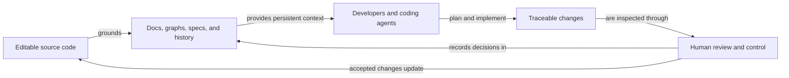

# FiboCode — A Living Codebase Knowledge Base for Agent Workflows

> **Understand Every Codebase.**
>
> From code to understanding—for humans and AI agents.

[Official Website](https://fibocode.ai/) · [Download FiboCode](https://fibocode.ai/download) · [Quick Start Documentation](https://fibocode.ai/docs) · [Latest GitHub Release](https://github.com/Alenkz12/FiboCode-Releases/releases/latest)

FiboCode is a local-first code editor with a living codebase knowledge base for agent workflows. It connects source code, Markdown documentation, relationship graphs, specifications, designs, plans, change records, and project history in one traceable workspace.

Keep the Agent CLI you already trust. FiboCode gives it persistent, repository-native context—and gives you an IDE-grade surface for reviewing the code it changes. It works alongside Claude Code, Codex, Gemini CLI, OpenCode, and other terminal-based coding agents instead of asking you to replace your existing workflow.

FiboCode is built for developers and teams who need to understand unfamiliar or long-lived codebases, preserve project knowledge across agent sessions, turn requirements into traceable changes, and keep the final review under human control.

> **About this repository:** this is the official FiboCode distribution repository. It hosts release binaries and update metadata; the product source code is not published here.

## What You Can Do with FiboCode

| Capability | What it helps you do |
| --- | --- |
| [Codebase Understanding](https://fibocode.ai/features/codebase-understanding) | Explore code, connected Markdown docs, relationship graphs, and project history to understand an unfamiliar or complex codebase faster. |
| [Context Engineering for Coding Agents](https://fibocode.ai/features/context-engineering) | Keep specs, designs, plans, change records, code, docs, and graphs with the repository so coding agents receive durable project context instead of a one-off prompt. |
| [Spec-Driven Development](https://fibocode.ai/features/spec-driven-development) | Turn requirements into specifications, designs, implementation plans, agent execution, code review, and traceable change records. |
| [AI Code Review](https://fibocode.ai/features/ai-code-review) | Inspect agent-generated changes through automatic diff summaries, focused hunks, single-column diff review, message snapshots, history, and rollback while keeping the final judgment human. |

## One Connected Agent Workflow



Source code remains the ground truth. Documentation explains it, graphs reveal relationships, and specifications and change records preserve why the software evolved. After a reviewed change returns to the codebase, its decisions and evidence strengthen the shared context available for the next human or agent task.

## Download and Install

For the easiest platform-specific download, visit the official [FiboCode download page](https://fibocode.ai/download). You can also download installers directly from [GitHub Releases](https://github.com/Alenkz12/FiboCode-Releases/releases/latest).

| Platform | Installer | Support |
| --- | --- | --- |
| macOS | `FiboCode-<version>-arm64-mac.dmg` | Apple Silicon |
| Windows | `FiboCode-Setup-<version>.exe` | Windows installer |
| Linux | `FiboCode-<version>-x86_64.AppImage` | x86_64 AppImage |

### macOS

1. Open the `.dmg` file.
2. Drag FiboCode into the Applications folder.
3. If macOS blocks the first launch, open **System Settings → Privacy & Security** and choose **Open Anyway**.

### Windows

Run the `.exe` installer and follow the setup wizard.

### Linux

```bash
chmod +x FiboCode-<version>-x86_64.AppImage
./FiboCode-<version>-x86_64.AppImage
```

## Local-First Privacy

FiboCode processes your source code and workspace data locally and does not upload or store them on FiboCode's own servers. If you choose to invoke a third-party AI model or Agent CLI, the code or context you send is transmitted directly to that provider under its own terms. See the [FiboCode Privacy Policy](https://fibocode.ai/privacy) for details.


## Learn More

- Read the [FiboCode Quick Start](https://fibocode.ai/docs) for installation, model configuration, terminal workflows, code analysis, and Fibo Skills.
- Explore practical guides on the [FiboCode Blog](https://fibocode.ai/blog).
- Follow upcoming work and submit ideas on the [FiboCode Roadmap](https://fibocode.ai/roadmap).
- Review plans for personal and organizational use on the [FiboCode Pricing and Licensing](https://fibocode.ai/pricing) page.
- Visit the [official FiboCode website](https://fibocode.ai/) for product demos, feature details, and current downloads.

## License and Commercial Use

FiboCode is free for personal use, including learning, personal projects, and open-source work. Use for the work of a for-profit organization requires a commercial license. Read the current [pricing and licensing overview](https://fibocode.ai/pricing) and [FiboCode EULA](https://fibocode.ai/eula) before use.

## Feedback and Support

Found a bug or have a feature request?

- [Report a bug](https://github.com/Alenkz12/FiboCode-Releases/issues)
- [Join the community discussion](https://github.com/Alenkz12/FiboCode-Releases/discussions)
- [Share a roadmap idea](https://fibocode.ai/roadmap)

---
name: FiboCode Release Repository README

update-time: 2026-08-07 05:55

description: Official FiboCode release repository overview with product capabilities, platform downloads, documentation, support channels, and links to fibocode.ai

---
