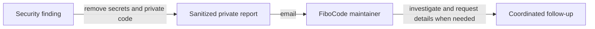
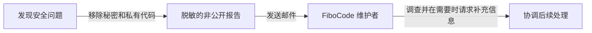

# FiboCode Security Policy

FiboCode is maintained independently by the FiboCode maintainer. This policy describes a practical private-reporting process; it does not imply a separate security team, a bug-bounty program, or a guaranteed response time.

## Reporting a Vulnerability

Please report suspected vulnerabilities privately by emailing [qfy1390974313@gmail.com](mailto:qfy1390974313@gmail.com) with the subject `[FiboCode Security] short description`.

Do not open a public GitHub Issue if the report contains or could expose source code, credentials, personal data, an unpublished exploit, or another user's information. Do not include a working secret in your email; replace it with a clearly marked placeholder.

Include the minimum information needed to investigate:

- FiboCode version, operating system, and installation type.
- The affected feature and, when relevant, the configured model Provider or Agent CLI.
- Reproduction steps, expected behavior, and actual behavior.
- The possible impact and whether it has been observed or is theoretical.
- Sanitized logs, screenshots, network destinations, or sample files that do not contain private code or valid credentials.

The maintainer will review reports as availability permits, may request additional information, and will try to coordinate any public disclosure after the risk is understood. No fixed acknowledgement, remediation, or release deadline is promised.

## Current Data Boundary

FiboCode does not upload or store workspace data on FiboCode-controlled servers. If you invoke a remote model, the request may send relevant code, complete selected file contents, paths, generated analysis, configuration values, and related context directly to the Provider you configured. That Provider's privacy policy and terms control its retention, training, and deletion practices.

Before analyzing a sensitive repository, remove API keys, passwords, tokens, and other secrets; review the included file types; and use a Provider or self-hosted OpenAI-compatible endpoint that you trust. See the [FiboCode Privacy Policy](https://fibocode.ai/privacy) for the complete disclosure.

## Supported Versions

Security fixes, when available, are normally delivered in the latest published release. Before reporting, please check whether the issue reproduces on the latest version. Older versions may not receive a separate fix.

---

# FiboCode 安全政策

FiboCode 由 FiboCode 维护者独立维护。本政策提供一个个人维护者能够兑现的非公开报告流程；它不代表 FiboCode 已设立专门安全团队、漏洞奖励计划或固定响应时限。

## 报告安全问题

请发送邮件至 [qfy1390974313@gmail.com](mailto:qfy1390974313@gmail.com)，使用主题 `[FiboCode Security] 简短描述`，以非公开方式报告疑似漏洞。

如果报告包含或可能暴露源代码、凭据、个人数据、未公开利用方式或其他用户的信息，请勿创建公开 GitHub Issue。请勿在邮件中放入仍然有效的真实秘密；应使用清楚标记的占位值替换。

请提供调查所需的最少信息：

- FiboCode 版本、操作系统和安装包类型。
- 受影响的功能；如果相关，请说明配置的模型 Provider 或 Agent CLI。
- 复现步骤、预期行为和实际行为。
- 可能造成的影响，以及该影响已经发生还是理论推断。
- 不含私有代码或有效凭据的脱敏日志、截图、网络目标或示例文件。

维护者会在时间允许时审阅报告，可能请求补充信息，并会在理解风险后尽力协调公开披露。本政策不承诺固定的确认、修复或发布期限。

## 当前数据边界

FiboCode 不会将工作区数据上传或存储到 FiboCode 控制的服务器。调用远程模型时，请求可能把相关代码、所选文件的完整内容、路径、生成的分析、配置值和相关上下文直接发送给你配置的 Provider。数据保留、模型训练和删除规则由该 Provider 的隐私政策与服务条款决定。

分析敏感仓库前，请移除 API Key、密码、Token 和其他秘密，检查会被纳入分析的文件类型，并使用你信任的 Provider 或自托管 OpenAI-compatible Endpoint。完整说明请参阅 [FiboCode 隐私政策](https://fibocode.ai/zh-CN/privacy)。

## 支持的版本

安全修复如有发布，通常会包含在最新公开版本中。报告前，请先确认问题能否在最新版复现。旧版本不一定会获得单独修复。

---
name: FiboCode Security Policy / FiboCode 安全政策

update-time: 2026-08-11 08:06

description: FiboCode 私人安全报告流程与数据边界。

---
